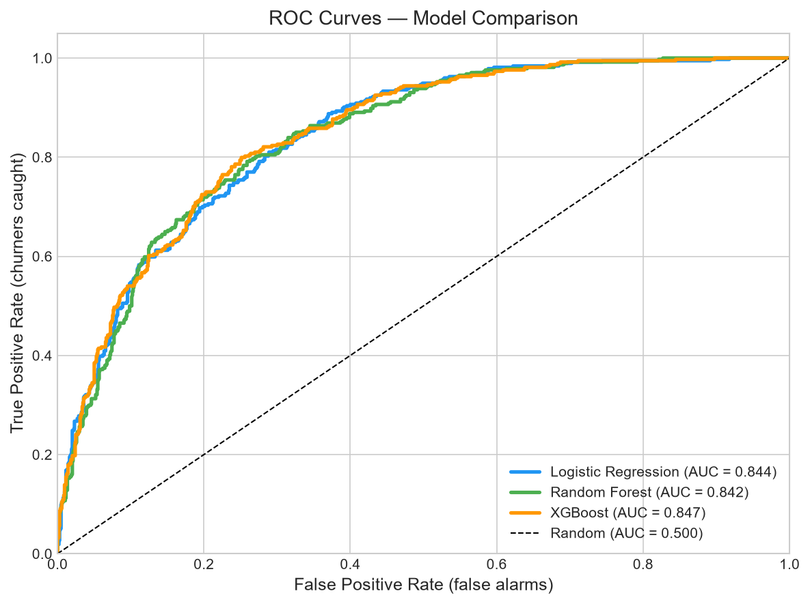
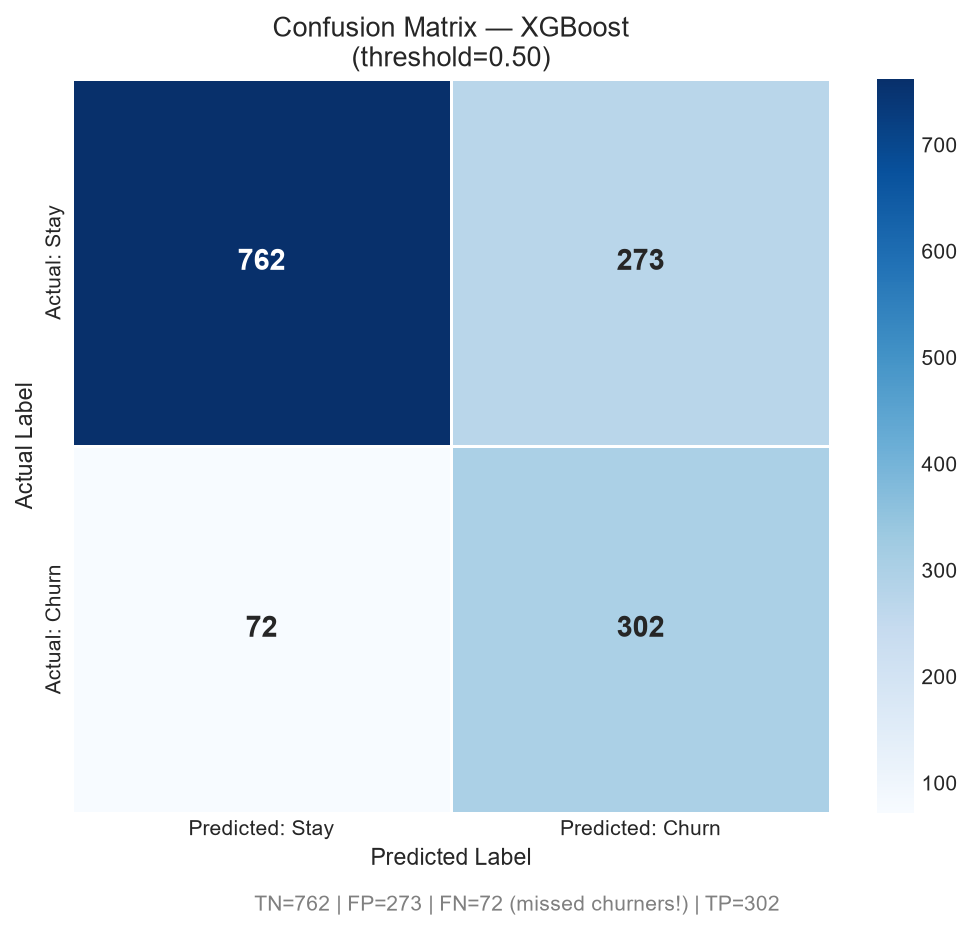
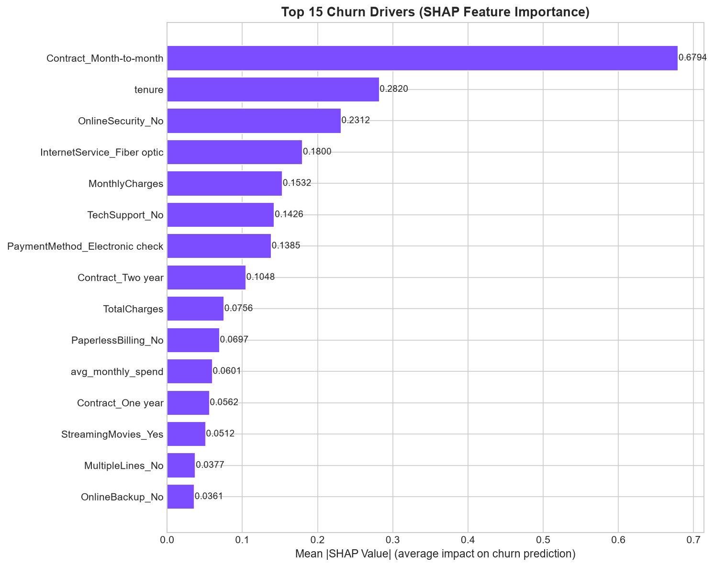

# 📡 Customer Churn Prediction

> **End-to-end Machine Learning system** that predicts whether a telecom customer will churn (cancel their subscription), complete with a deployed web app and SHAP explainability.

[](https://python.org)
[](https://scikit-learn.org)
[](https://xgboost.readthedocs.io)
[](https://streamlit.io)

---

## 🎯 Problem Statement

Customer churn is one of the most expensive problems in telecom. Acquiring a new customer costs **5–7× more** than retaining an existing one. If a company with 1M customers has 26% annual churn, that's 260,000 lost customers per year.

This project builds a machine learning system that:
1. **Predicts** which customers are likely to churn (before they leave)
2. **Explains** *why* using SHAP (SHapley Additive exPlanations)
3. **Recommends** specific retention actions for each at-risk customer
4. **Deploys** as an interactive web app for business users

---

## 📊 Dataset

**IBM Telco Customer Churn** — [Download from Kaggle](https://www.kaggle.com/datasets/blastchar/telco-customer-churn)

| Property | Value |
|----------|-------|
| Source | IBM Sample Dataset |
| Rows | 7,043 customers |
| Features | 19 (demographics, services, billing) |
| Target | Churn (Yes/No) |
| Class Balance | ~26% churn / ~74% not churn |

**To use this dataset:**
1. Download `WA_Fn-UseC_-Telco-Customer-Churn.csv` from Kaggle
2. Place it at `data/raw/WA_Fn-UseC_-Telco-Customer-Churn.csv`

---

## 🏗️ Project Structure

```
churn-prediction/
├── data/
│   ├── raw/                          # Raw CSV from Kaggle (not in git)
│   └── processed/                    # Train/test splits (not in git)
│
├── notebooks/
│   ├── 01_eda.ipynb                  # Exploratory Data Analysis
│   └── 02_modeling.ipynb             # Model training & evaluation
│
├── src/
│   ├── __init__.py
│   ├── data_preprocessing.py         # Load, clean, fix data issues
│   ├── features.py                   # Feature engineering + sklearn pipeline
│   ├── train.py                      # Train & tune 3 ML models
│   ├── evaluate.py                   # Metrics, plots, threshold tuning
│   └── predict.py                    # Prediction interface
│
├── models/
│   └── xgboost_pipeline.pkl          # Saved best model (not in git)
│
├── app/
│   └── streamlit_app.py              # Interactive web app
│
├── reports/
│   └── figures/                      # Saved charts and plots
│
├── tests/
│   ├── __init__.py
│   ├── test_preprocessing.py         # Tests for data cleaning
│   └── test_predict.py               # Tests for prediction interface
│
├── requirements.txt                  # Pinned dependencies
├── .gitignore
└── README.md
```

---

## ⚙️ Setup & Installation

### 1. Prerequisites
- Python 3.10+ ([download](https://python.org/downloads/))
- Git ([download](https://git-scm.com/downloads))

### 2. Clone the Repository
```bash
git clone https://github.com/Prateek22678/Customer-Churn-Prediction.git
cd Customer-Churn-Prediction
```

### 3. Create Virtual Environment
```bash
python -m venv venv

# Activate on Windows:
venv\Scripts\activate

# Activate on Mac/Linux:
source venv/bin/activate
```

### 4. Install Dependencies
```bash
pip install -r requirements.txt
```

### 5. Add the Dataset
Download from [Kaggle](https://www.kaggle.com/datasets/blastchar/telco-customer-churn) and place at:
```
data/raw/WA_Fn-UseC_-Telco-Customer-Churn.csv
```

---

## 🚀 Running the Project

### Step 1: Train the Models
```bash
python -m src.train
```
This will:
- Load and clean the data
- Engineer features
- Train Logistic Regression, Random Forest, and XGBoost
- Run RandomizedSearchCV with 5-fold cross-validation
- Save the best model to `models/xgboost_pipeline.pkl`

### Step 2: Evaluate (Optional)
```bash
python -m src.evaluate
```
Generates plots in `reports/figures/`.

### Step 3: Run the Web App
```bash
streamlit run app/streamlit_app.py
```
Opens at http://localhost:8501

### Step 4: Run Tests
```bash
pytest tests/ -v
```

---

## 📈 Results

### Model Comparison (Test Set, threshold=0.50)

### Model Comparison (Test Set, 1,409 customers, threshold=0.50)

| Model | Accuracy | Precision | Recall | F1 | ROC-AUC |
|-------|----------|-----------|--------|-----|---------|
| Logistic Regression | 0.7381 | 0.5043 | 0.7914 | 0.6160 | 0.8439 |
| Random Forest | 0.7360 | 0.5017 | 0.8048 | 0.6181 | 0.8424 |
| **XGBoost** ✅ | **0.7615** | **0.5339** | **0.7995** | **0.6403** | **0.8467** |

**XGBoost at tuned threshold=0.52** (maximizes F1 for business use):

| Metric | Score |
|--------|-------|
| Accuracy | 0.7615 |
| Precision | 0.5339 |
| **Recall** | **0.7995** (catches 80% of all churners) |
| F1 Score | 0.6403 |
| **ROC-AUC** | **0.8467** |

> **Why XGBoost?** Highest ROC-AUC (0.8467) and F1 (0.6403). Threshold tuned to 0.52 to maximise recall — catching churners matters more than false alarms in this business context.

### Key Charts

| Chart | Description |
|-------|-------------|
|  | ROC curves for all 3 models |
|  | XGBoost confusion matrix |
|  | Top churn drivers |

---

## 🔍 Key Insights (SHAP Analysis)

Based on SHAP feature importance on the test set, the top drivers of churn are:

| Rank | Feature | Mean |SHAP| | Business Meaning |
|------|---------|-----------|-----------------|
| 1 | `Contract_Month-to-month` | **0.6794** | Strongest signal — 43% churn vs 3% for Two-year |
| 2 | `tenure` | **0.2820** | Short tenure = high risk; drops sharply after 24 months |
| 3 | `OnlineSecurity_No` | **0.2312** | No security add-on = 2× higher churn |
| 4 | `InternetService_Fiber optic` | **0.1800** | Fiber customers churn at 42% — pricing/satisfaction issue |
| 5 | `MonthlyCharges` | **0.1532** | Higher charges → more price-sensitive churn |
| 6 | `TechSupport_No` | **0.1426** | No tech support = frustrated customers leave |
| 7 | `PaymentMethod_Electronic check` | **0.1385** | 45% churn — manual payment = less friction to leave |

### Recommended Retention Actions
1. 📋 **Offer discounted long-term contracts** to month-to-month customers showing churn signals (strongest driver at 0.68 SHAP)
2. 🎁 **First-year loyalty programme** — customers in months 0–12 have the highest risk; proactive outreach or a loyalty milestone reward
3. 🔒 **Bundle OnlineSecurity + TechSupport** for Fiber optic customers — reduces churn signals #3, #4, and #6 simultaneously

---

## 🌐 Web App

The Streamlit app lets you:
- Enter any customer's details via a sidebar form
- See their churn probability with a visual gauge
- View SHAP-based explanation of *why* they're at risk
- Get 3 personalized retention action recommendations

**Screenshot:** *(Add after running app)*

---

## 🧪 Testing

```bash
pytest tests/ -v --cov=src --cov-report=term-missing
```

Tests cover:
- Data cleaning (TotalCharges fix, customerID drop, target encoding)
- Feature engineering (new columns, value ranges, no division-by-zero)
- Risk level mapping (probability boundaries)
- Prediction interface (output structure, determinism, consistency)

---

## 📦 Tech Stack

| Library | Version | Purpose |
|---------|---------|---------|
| pandas | ≥2.2 | Data manipulation |
| numpy | ≥1.26 | Numerical computing |
| scikit-learn | ≥1.5 | ML pipeline, models, CV |
| imbalanced-learn | ≥0.12 | SMOTE, class weights |
| xgboost | ≥2.1 | Gradient boosting model |
| matplotlib/seaborn | ≥3.9/0.13 | Visualization |
| shap | ≥0.46 | Model explainability |
| joblib | ≥1.4 | Model persistence |
| streamlit | ≥1.38 | Web app |
| pytest | ≥8.3 | Testing |

---

## ⚠️ Limitations

- Trained on a single snapshot dataset (no temporal validation)
- US telecom market data — may not generalize to other markets
- SHAP explanations are per-prediction, not globally causal
- The model doesn't account for recent customer behavior changes (no real-time features)

---

## 🔮 Future Improvements

- [ ] Add real-time data pipeline (Kafka/Airflow)
- [ ] A/B test retention interventions
- [ ] Add customer lifetime value (CLV) to prioritize which churners to intervene on
- [ ] Experiment with neural networks (TabNet, FT-Transformer)
- [ ] Build a REST API with FastAPI for production integration
- [ ] Add monitoring for model drift (Evidently AI)

---

## 🚀 Deployment

### Streamlit Community Cloud (Free)
1. Push to GitHub (public repo)
2. Go to [share.streamlit.io](https://share.streamlit.io)
3. Connect your repo → Set main file: `app/streamlit_app.py`
4. **Important:** Add `models/xgboost_pipeline.pkl` to git (remove from `.gitignore` temporarily) or use `st.cache_resource` with a remote download

### Hugging Face Spaces (Alternative)
1. Create a Space at [huggingface.co/spaces](https://huggingface.co/spaces)
2. Choose "Streamlit" SDK
3. Upload all files including the model

---

## 👤 Author

Built as a portfolio ML project demonstrating end-to-end data science skills.

- EDA → Preprocessing → Feature Engineering → Model Training → Evaluation → Explainability → Deployment

---

*Data source: IBM Sample Data — [Kaggle](https://www.kaggle.com/datasets/blastchar/telco-customer-churn)*
